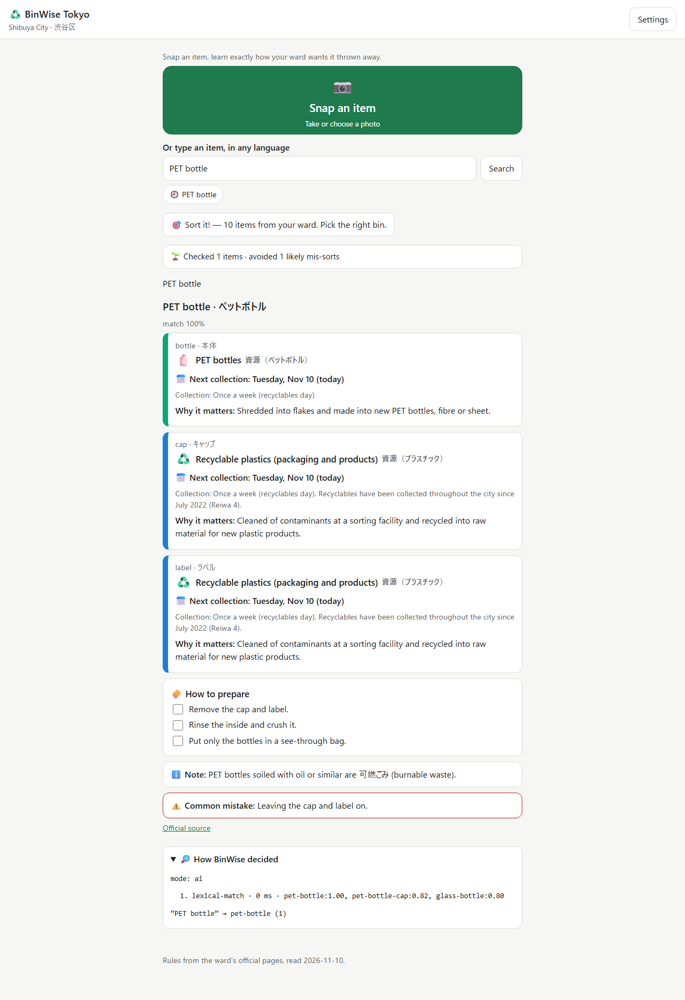
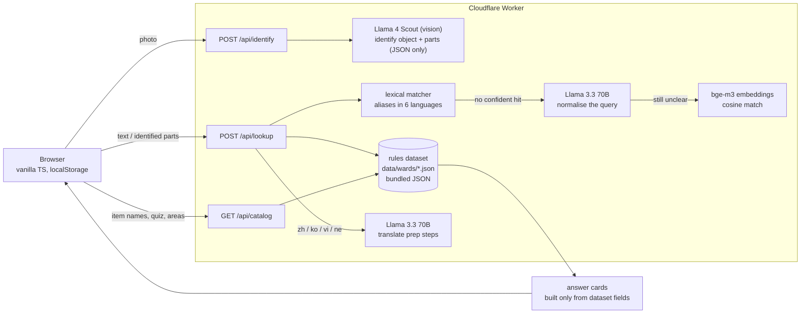

# BinWise Tokyo ♻️

**Snap an item, learn exactly how your ward wants it thrown away.**

Live: https://binwise.shotaro-takakura.workers.dev · Built for [Arbiter Hacks V1](https://arbiter-hacks-v1.devpost.com), Theme Track "Rethinking Waste".

> BinWise is an unofficial guide. The ward's own pages always take precedence, and every answer links to them.



## What and why

Every Tokyo ward sets its own sorting rules, and they disagree. Plastic is a recyclable in Shibuya and Shinjuku but burnable in Setagaya. Fluorescent tubes are a recyclable in Shibuya and non-burnable elsewhere. The rules are published mostly in Japanese, in long pages and PDFs. Newcomers, students and foreign residents get them wrong. As a result, recyclables are burned (16.6% of Setagaya's burnable household waste is material the ward already recycles), batteries start fires in garbage trucks, and bags are left on the street with a violation sticker. See [docs/impact.md](docs/impact.md).

BinWise covers **Shibuya, Shinjuku and Setagaya**:

- **Snap or type an item**, in English, Japanese, Chinese, Korean, Vietnamese or Nepali ("pizza box", "電池", "used frying oil").
- AI identifies the item and its **separable parts**: a PET bottle is a bottle, a cap and a label. Each part is looked up in a **curated rules dataset** for your ward: 181 items per ward, built from the official ward pages.
- **Answer card per part**: the category (colour, icon and text), preparation steps as a checklist, **your next collection day** ("Monday, Dec 14 (in 34 days)"), what happens to the item afterwards, the common mistake, and the official source link.
- **"How BinWise decided"**: the matching steps, models, timings and scores behind every answer.
- **My collection days**: set once per ward (Shibuya can fill them in from your 町丁目). Stored in localStorage only.
- **"Sort it!" quiz**: 10 items from your ward, instant feedback and explanations.
- **Impact counter**: items checked, and lookups of items people commonly mis-sort.
- **Unknown items**: "not in our dataset" plus a link to the ward's official search. BinWise never guesses.

## Run it offline

Requirements: Node.js 20+.

```sh
npm install
npm run dev            # builds the frontend, starts wrangler dev with wrangler.offline.jsonc on http://localhost:8798
```

The offline config has no Workers AI binding. Matching is then deterministic and lexical (aliases in six languages), photo recognition is disabled, and the trace says `lexical-fallback`.

Checks:

```sh
npm run build && npx tsc --noEmit && npx vitest run
npx wrangler deploy --dry-run --outdir dist-dry
node scripts/smoke.mjs                 # headless Chromium UI smoke test + screenshots in docs/screenshots/
node scripts/check-sources.mjs         # are the official source pages unchanged?
node scripts/record-demo.mjs           # demo-out/raw.webm + marks.json (captioned walkthrough)
```

Deploy (needs a Cloudflare account with Workers AI): `npm run deploy`.

## Architecture



- **Cloudflare Workers** serves the static frontend from `public/` and the APIs under `/api/*`. There is no database: the dataset is JSON bundled into the worker.
- **Workers AI**: `@cf/meta/llama-4-scout-17b-16e-instruct` identifies items in photos (`@cf/mistralai/mistral-small-3.1-24b-instruct` takes over if it fails), `@cf/meta/llama-3.3-70b-instruct-fp8-fast` normalises queries and translates, and `@cf/baai/bge-m3` provides multilingual embeddings for fuzzy matching. Item embeddings are computed on the first request and cached in memory.
- Without AI (offline or on errors), lexical matching runs in English and Japanese, and the trace marks this.
- Hardening: text inside images and queries is treated as data, not instructions. Images are limited to 5 MB, requests to 30 per minute per IP, responses are `Cache-Control: no-store`, and images are never logged or stored.

| Path | What |
|---|---|
| `src/worker/` | API: `api.ts` (lookup and identify), `ai.ts` (model calls), `match.ts`, `catalog.ts` |
| `src/client/` | Frontend: `app.ts`, `i18n.ts` (six languages), `schedule.ts` (next collection day) |
| `data/research/`, `data/src/` | Hand-curated rules (Japanese, quoted from ward pages), English text, shared item list |
| `data/wards/` | Generated dataset (`npm run data`), validated by `scripts/validate-data.mjs` |
| `data/source-hashes.json` | Baseline for `scripts/check-sources.mjs` |

## Data provenance

All rules come from the wards' official websites, read on 2026-11-10. Every URL, what was taken from it, and each ward's terms of use are listed in **[docs/data-sources.md](docs/data-sources.md)**.

- 181 items per ward with shared ids, so the same item maps in all three wards. Each item has a `source` URL and a `derived` flag:
  - `derived: false`: the ward lists the item by name.
  - `derived: true`: the category follows from a general ward rule, and that rule is quoted in `ruleQuote`.
  - Items that no official page covers go to a "not listed / ask the office" category instead of being guessed.
- `samples/water-bottle.jpg` (used by the demo recording) is "Bottle of Water.jpg" from Wikimedia Commons, released under CC0.
- Rules are used as facts. Verbatim text is kept only as short quotations with their source, and no images, PDFs or layouts are copied.
- `scripts/check-sources.mjs` detects when an official page changes, so the dataset can be re-checked (monthly).

## Responsible AI

- **Answers are grounded in the dataset.** The AI identifies items, matches wording and translates. It never decides a category or invents a rule: every category, preparation step and collection note on a card comes from a dataset field with a source link.
- **Honest uncertainty.** Weak matches show a confidence and the top 3 alternatives, and unknown items get "not in the dataset" plus the official search link.
- **Transparent.** "How BinWise decided" shows the steps, the models, the matched item and its score. In languages other than Japanese and English, the original text is one tap away from the machine translation.
- **Private by design.** There are no accounts. Settings, recent searches and the impact counter stay in the browser's localStorage, and photos are processed for the request only.
- **Known limits.** The interface text in Chinese, Korean, Vietnamese and Nepali has not yet been reviewed by native speakers. Only three wards are covered.

## Built with Llama

BinWise uses Meta Llama models via Cloudflare Workers AI: Llama 4 Scout and Llama 3.3 70B Instruct. **Built with Llama.** Llama 4 is licensed under the [Llama 4 Community License](https://www.llama.com/llama4/license/), Copyright © Meta Platforms, Inc. All Rights Reserved. Llama 3.3 is licensed under the [Llama 3.3 Community License](https://www.llama.com/llama3_3/license/). The embedding model is BAAI bge-m3 (MIT).

## Licences

- Code: [MIT](LICENSE) © 2026 Shotaro Takakura.
- Ward rules: facts from the official sites of 渋谷区, 新宿区 and 世田谷区, used with attribution. The wards keep the copyright to their pages (see [docs/data-sources.md](docs/data-sources.md)).
- Model licences: see "Built with Llama" above.
